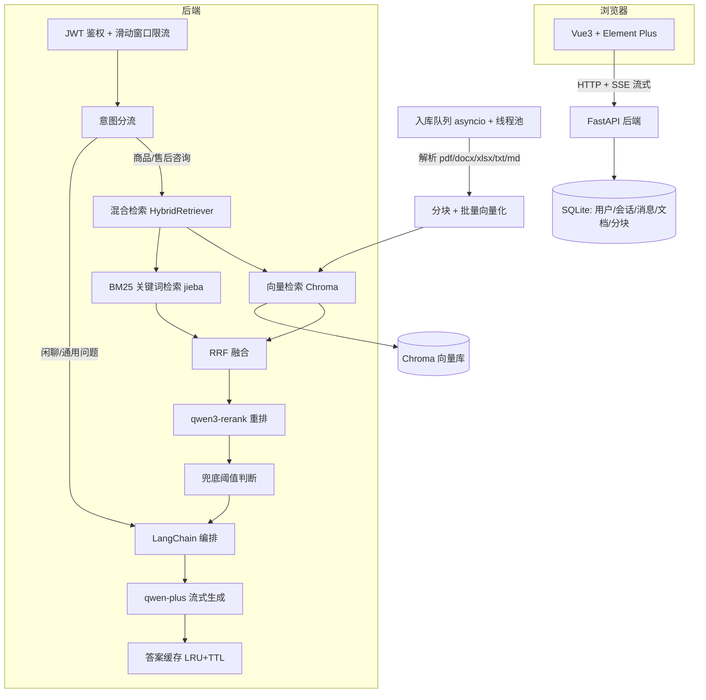

# RAG 电商知识库问答系统

> 基于 LangChain 的企业级 RAG 知识库问答系统：面向电商商品咨询场景，单机可跑、Docker 一条命令部署。
> 多用户多会话 · 流式回答 · 知识库引用溯源 · 混合检索 + 重排 · 答案缓存与限流。

## 架构



## 功能列表

| 模块 | 功能 |
|---|---|
| 用户体系 | 注册/登录/修改密码；bcrypt 密码哈希 + JWT；管理员与普通用户权限隔离（前端隐藏入口 + 后端二次鉴权） |
| 知识库管理（仅管理员） | 多文件上传（5 种格式）、后台异步入库（状态流转：待处理→处理中→已入库/失败）、状态自动轮询、失败原因提示、分块预览、重新解析、删除 |
| 智能问答 | 流式输出（SSE）、回答中 [1][2] 引用角标、右侧引用面板（来源文档/相关度/片段全文）、停止生成 |
| 多会话 | 每个用户独立会话列表、新建/重命名/删除、历史消息持久化跨登录恢复、首问自动生成标题 |
| 检索增强 | 向量 + BM25 混合检索 → RRF 融合 → 重排复试；商品问题严格依据资料作答、无相关资料时兜底不瞎编；闲聊问题自由对话 |
| 性能与安全 | 答案缓存（同问秒回）、登录/提问限流防刷、异步入库队列（崩溃自动恢复）、数据库索引、前端路由懒加载 |

## 快速启动

### 方式一：一键启动（Windows，开发模式）

1. 复制 `.env.example` 为 `backend/.env`，填入 `DASHSCOPE_API_KEY`
2. 双击 `start.bat` → 自动打开两个窗口并拉起浏览器（http://localhost:5173）
3. 管理员账号：`admin / 123456`

> bat 脚本为纯英文：Windows 老式编码下中文注释会乱码导致解析错乱。

### 方式二：Docker 部署（生产模式，单容器跑全栈）

```bash
docker compose up -d --build
# 访问 http://localhost:8000
```

可选的前后端分离拓扑（nginx 托管前端 + 反代 API）：

```bash
docker compose --profile web up -d --build
# 访问 http://localhost:8080
```

### 方式三：手动命令

```bash
# 后端（Python 3.12）
cd backend
python -m venv .venv
.venv\Scripts\activate
pip install -r requirements.txt
uvicorn app.main:app --reload          # http://localhost:8000/docs

# 前端
cd frontend
npm install
npm run dev                            # http://localhost:5173
```

## 技术栈

| 层 | 技术 | 选型理由 |
|---|---|---|
| 前端 | Vue 3 + Vite + Element Plus + Pinia | 国内生态成熟，组件丰富，快速搭建企业级界面 |
| 后端 | Python 3.12 + FastAPI + LangChain | LangChain 统一编排检索/生成；FastAPI 原生异步 + SSE 流式 |
| 大模型 | 阿里云百炼：qwen-plus / text-embedding-v3 / qwen3-rerank | 国内直连、便宜、对话/向量/重排一个平台全覆盖（OpenAI 兼容模式） |
| 向量库 | Chroma（嵌入式） | 零部署开箱即用；检索层已抽象，量级增长可换 server 模式 |
| 数据库 | SQLite + SQLAlchemy | 免安装单文件；换 MySQL 只改环境变量 |
| 工程化 | Docker compose / pytest（91 测试 93% 覆盖率）/ ruff / git | 可复现部署 + 测试兜底 + 代码规范 |

## 测试

```bash
cd backend
.venv/Scripts/python -m pytest -q                # 91 个测试，全程零 API 消耗
.venv/Scripts/python -m pytest --cov=app --cov-report=term-missing -q
.venv/Scripts/ruff check .
```

测试设计：所有外部依赖（大模型/向量化/重排/时钟）以接口注入，测试用假实现替代
（见 `backend/tests/fakes/`）；文档解析测试动态生成五种格式的样例文件。

## 设计决策记录（ADR）

| 决策 | 原因 |
|---|---|
| 用 Python 3.12 而非 3.14 | chromadb 依赖的 onnxruntime 无 3.14 的 wheel，且其依赖 pypika 使用了 3.14 已移除的 `ast.Str` |
| 重排模型用 `qwen3-rerank` 而非 `gte-rerank` | 阿里云已下架 gte-rerank 系列，官方推荐 qwen3-rerank（走 compatible-api 通道） |
| 向量化关闭 `check_embedding_ctx_length` | 新版 langchain-openai 默认把文字预分词成 token 编号发送，DashScope 兼容模式只收原始文字（官方推荐非 OpenAI 厂商关闭） |
| 意图分流：关键词路由 | 商品咨询走严格检索（防瞎编），闲聊自由对话；零成本可解释，更精准方案（小模型分类）列入后续规划 |
| BM25 用内存索引而非 SQLite FTS | 避免双检索路径维护成本；chunks 表是事实来源，重启全量重建（10 万块以下毫秒级） |
| 不引 Redis/Celery/Milvus | 单机可跑原则；缓存与队列均以接口抽象隔离，量级增长后可无缝替换 |
| 引用快照存消息表 | 历史消息重渲染无需再查库/查向量库，删除文档后历史回答仍可展示当时引用的原文 |

## 目录结构

```
├── backend/                # FastAPI + LangChain
│   ├── app/
│   │   ├── api/            # 路由层（鉴权/限流/参数校验）
│   │   ├── core/           # 安全组件（bcrypt/JWT/限流器）
│   │   ├── models/         # SQLAlchemy ORM（5 张表）
│   │   ├── rag/            # ★ RAG 核心（解析/分块/向量化/双路检索/RRF/重排/意图/提示词）
│   │   ├── schemas/        # Pydantic 请求响应模型
│   │   └── services/       # 业务编排（聊天/入库流水线/任务队列/缓存/文档管理）
│   └── tests/              # unit / api / rag 三层 + fakes 假实现
├── frontend/               # Vue 3 + Element Plus
│   └── src/                # views / components / stores(Pinia) / api(axios+SSE)
├── scripts/                # check_dashscope.py 一键验证 Key
├── docs/                   # architecture.md 架构与设计文档
├── start.bat               # Windows 一键启动（开发模式）
└── docker-compose.yml      # 生产部署（单容器 / nginx 双容器两种拓扑）
```

## 后续优化路线

- [ ] 检索效果评测集（Top-K 召回率、混合 vs 纯向量、重排前后对比）
- [ ] 多轮问题改写（query rewrite）：结合上文改写检索词，提升多轮场景命中率
- [ ] 扫描版 PDF 的 OCR 识别（PaddleOCR）
- [ ] 小模型意图分类替代关键词路由
- [ ] Redis 缓存 / Celery 任务队列（接口已预留）
- [ ] Chroma server 模式 / Qdrant（语料超过 10 万块时）
